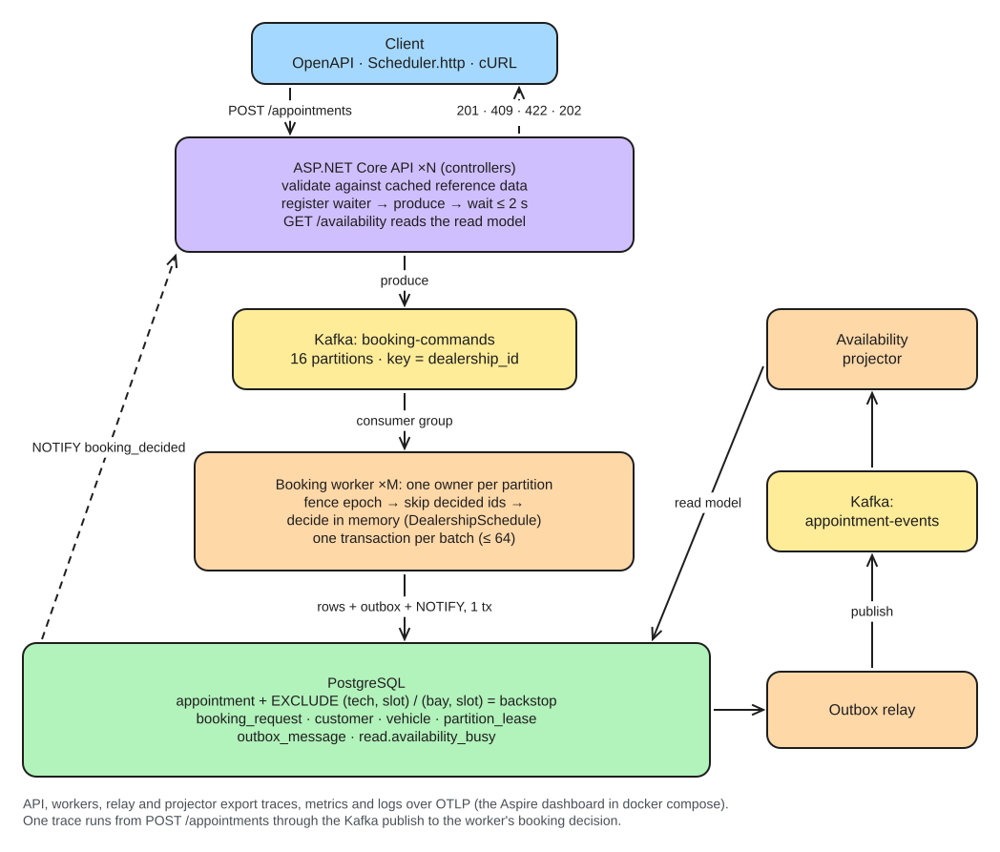

# Unified Service Scheduler

Keyloop technical assessment, **Scenario A** (Ownership domain). A backend service that books workshop
appointments only when a **qualified technician and a service bay are both free for the whole service
duration**, and stays correct when many customers book the same slot at once.

Each dealership has exactly one writer. Booking requests go onto a Kafka partition chosen by dealership; the
worker that owns that partition decides them in batches from an in-memory schedule and commits each batch in
one Postgres transaction, with exclusion constraints underneath as a backstop. The API waits up to 2 s for the
decision, so a client normally gets its final answer in one call.



Editable source: [docs/diagrams/architecture.excalidraw](docs/diagrams/architecture.excalidraw) (open at excalidraw.com).

**Stack:** C# · .NET 10 (LTS) · ASP.NET Core · Apache Kafka (KRaft) · PostgreSQL 16 · EF Core + Npgsql ·
xUnit v3 + Testcontainers · OpenTelemetry · Docker Compose.

## Run it

Needs Docker with Compose v2.

```bash
docker compose -f deploy/docker-compose.yml up --build
```

| What | Where |
|---|---|
| API | http://localhost:8080 |
| Interactive API docs (Swagger UI): try every endpoint from the browser | http://localhost:8080/swagger |
| OpenAPI document | http://localhost:8080/openapi/v1.json |
| Traces, metrics, logs (Aspire dashboard) | http://localhost:18888 |
| Postgres (user/password `scheduler`) | `localhost:55432` |
| Kafka, for tools on the host | `localhost:29092` |

The stack migrates the database and loads demo data (three dealerships in London, Ho Chi Minh City and
New York) before the API and two workers start.

**Try it:** [`Scheduler.http`](Scheduler.http) walks through every case: confirm, idempotent retry, no
capacity (409), skill matching, outside opening hours (422), validation (400), async 202 + polling, and
availability. Or with cURL:

```bash
curl -i -X POST localhost:8080/appointments -H 'Content-Type: application/json' -d '{
  "dealershipId": 1, "serviceType": "OIL", "start": "2027-03-04T09:00:00+00:00",
  "customer": { "name": "Ava Thompson", "email": "ava.thompson@example.com" },
  "vehicle": { "vin": "WVWZZZ1KZAW000001", "make": "Volkswagen", "model": "Golf" } }'
```

## Demo

The client layer is mocked, as the brief allows for a backend submission. Three tools cover the demo:

1. **Single requests**: [Swagger UI](http://localhost:8080/swagger) in the browser, or [`Scheduler.http`](Scheduler.http)
   in an editor, or `demo/book.sh` for one readable line per booking. Book a slot (201), fill it (409), book outside opening hours (422), send bad input (400),
   ask for `Prefer: respond-async` (202) and poll it.
2. **Concurrency**: `demo/burst.sh` fires 50 simultaneous bookings for one slot and checks the database.

   ```
   Dealership 3 (America/New_York): 3 technicians qualified for an oil change, 4 bays → capacity 3
     3 × 201 Created   47 × 409 No capacity   0 × other    slowest answer 0.56s
     appointments stored for that slot: 3    overlapping bookings in the database: 0
     ✔ exactly capacity booked, everyone else told no, nothing double-booked
   ```
3. **Failover**: `demo/failover.sh` sends 300 bookings and stops one of the two workers partway through.

   ```
     298 × 201   2 × 409 (slot already full)   0 × 202 (followed to an outcome)   0 × errors
     latency p50 0.078s   p99 1.15s   max 1.31s (the handover pause shows up in the tail)
     977de9ffd3d4-f3d879c0 now owns 16 partitions, epochs up to 7
     overlapping bookings in the database: 0
     ✔ every request answered through the failover, nothing double-booked
   ```

Then open the [Aspire dashboard](http://localhost:18888) → Traces → a `POST appointments` trace: one trace runs
from the API through the Kafka publish to the worker's `booking decide` span.

The scripts need bash, curl, python3 and the running compose stack; each run picks a fresh future slot,
so they can be repeated.

## Test it

Needs the .NET 10 SDK and Docker (the integration tests start their own Postgres and Kafka containers).

```bash
dotnet test
```

- **Unit tests** (`tests/Scheduler.UnitTests`, 20): the booking rules in isolation: half-open slot
  boundaries, skill matching, capacity, first-fit determinism, opening hours across a daylight-saving change,
  free-slot listing.
- **Integration tests** (`tests/Scheduler.IntegrationTests`, 12), against real Postgres and Kafka:
  - 50 simultaneous requests for 6 bays → exactly 6 × 201, 44 × 409, 0 overlaps
  - the confirmed record links customer, vehicle, technician and bay, and reads back (R3)
  - only qualified technicians are assigned
  - idempotent retries, 202 + polling, 400/422 responses
  - a Kafka replay after a crash books nothing twice
  - a worker that lost its partition cannot write (fencing)
  - bookings continue when a worker leaves and its partitions move
  - the database rejects an overlap even if application code attempts one
  - the availability read model catches up with bookings

The design-phase benchmark that compared approaches is separate: [bench/BookingConcurrency](bench/BookingConcurrency).

## API

| Method and path | Answers |
|---|---|
| `POST /appointments` | **201** confirmed (with technician, bay, customer, vehicle) · **409** no capacity · **422** can't be booked as asked (outside hours, unknown service, no qualified technician, in the past) · **400** invalid input · **202** still deciding, poll `Location`. Headers: `Idempotency-Key`, `Prefer: wait=N` / `respond-async`. |
| `GET /booking-requests/{id}` | 200 confirmed/rejected · 202 pending · 404 unknown |
| `GET /appointments/{id}` | 200 · 404 |
| `GET /availability?dealershipId=&serviceType=&date=` | Free start times on one local day (15-minute steps), from the eventually consistent read model |

Times are ISO 8601 with an offset; responses use the dealership's local offset. The contract is in
[docs/api/openapi.json](docs/api/openapi.json), exported from the running service (live at `/openapi/v1.json`).

## Repository layout

```
src/Scheduler.Domain          booking rules (no I/O): DealershipSchedule, TimeSlot, OpeningHours
src/Scheduler.Infrastructure  EF Core schema + migrations, reference-data cache, Kafka, telemetry
  └─ Data/                     every query: Shared/ (both), Write/ (worker), Read/ (api)
src/Scheduler.Api             controllers, reply waiter (LISTEN), command publisher, --migrate mode
src/Scheduler.Worker          booking worker (single writer), outbox relay, availability projector
tests/                        unit and integration tests
deploy/                       Dockerfile and docker-compose.yml
demo/                         book.sh, burst.sh and failover.sh
bench/                        the O1-vs-O2 concurrency benchmark
docs/                         requirements, design, decisions, AI log, benchmark results, diagrams
```

## Docs

- **[System Design Document (PDF)](docs/System-Design.pdf)**: the reviewer's overview in 6 diagram-led pages: options, the benchmark behind the choice, architecture, data model, key flows, proof.
- [Requirements and assumptions](docs/REQUIREMENTS.md)
- [System design](docs/DESIGN.md): architecture, sequence diagrams for each flow, consistency, scalability, observability
- [Decisions](docs/DECISIONS.md): every choice with the options and trade-offs considered
- [Booking concurrency benchmark](docs/benchmarks/BOOKING-CONCURRENCY.md): why one writer per dealership
