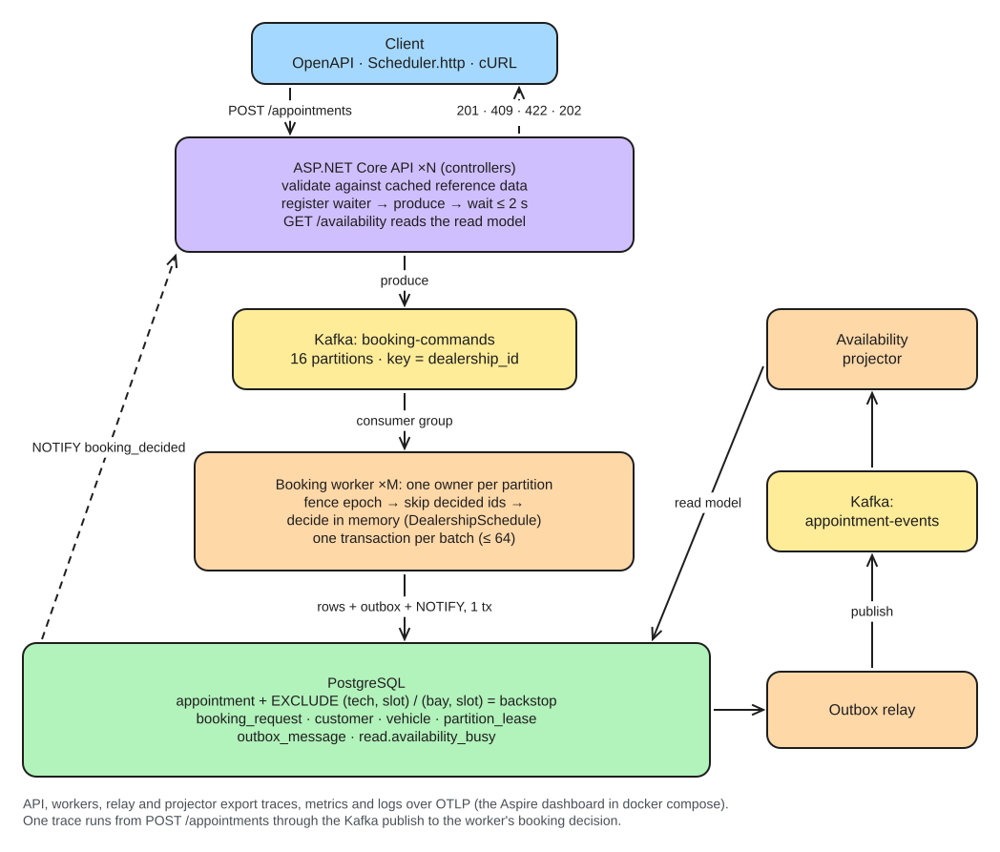
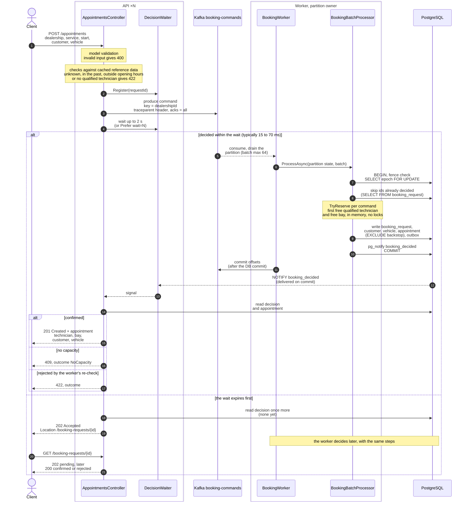
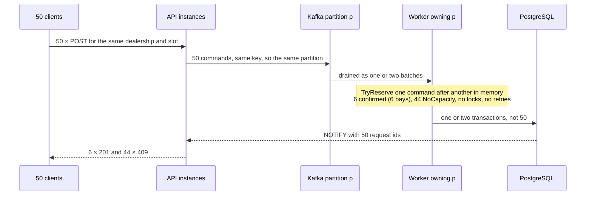
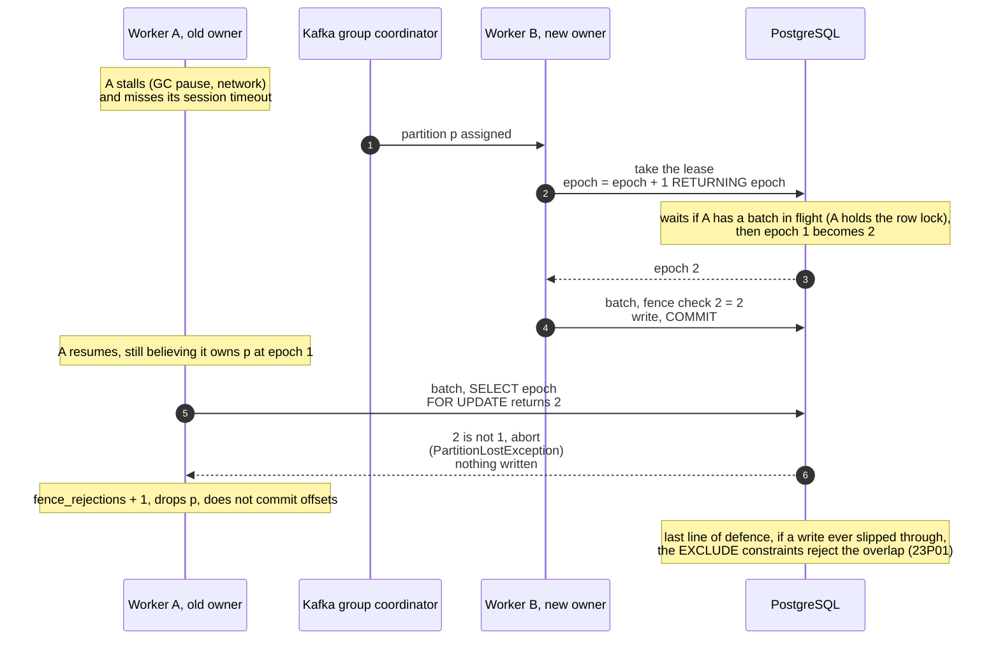
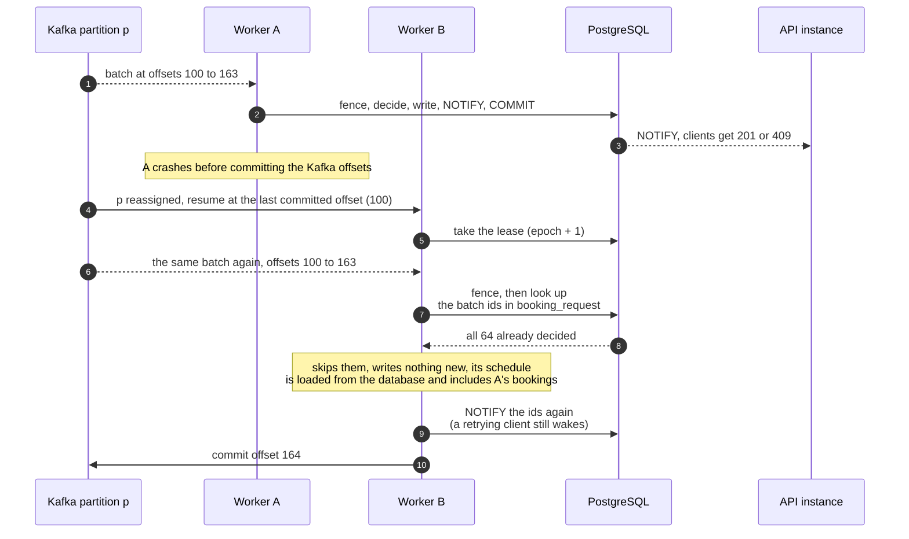
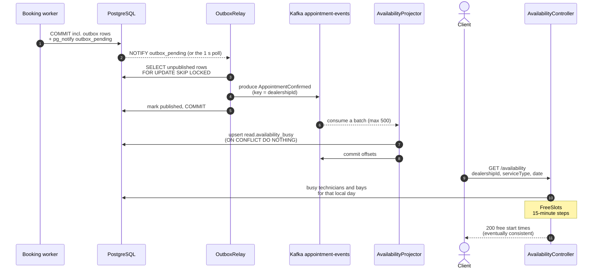

# System Design Document: Unified Service Scheduler

Status: **v1, as built**, 2026-11-03. Requirements and assumptions: [REQUIREMENTS.md](REQUIREMENTS.md).
Decisions with their trade-offs: [DECISIONS.md](DECISIONS.md). Measurements: [benchmarks/BOOKING-CONCURRENCY.md](benchmarks/BOOKING-CONCURRENCY.md).

**In one paragraph.** A booking is confirmed only if a qualified technician and a service bay are both free
for the whole service duration (R2). Instead of letting every request race inside the database, each
dealership has exactly one writer: requests are queued on a Kafka partition chosen by dealership, and the
worker that owns that partition decides them one batch at a time from an in-memory schedule, then commits
the batch in one transaction. Postgres exclusion constraints stay underneath as a backstop. The API waits up
to 2 s for the decision, so clients almost always get a final 201/409 in one call.

## 1. Architecture diagram



Editable source: [diagrams/architecture.excalidraw](diagrams/architecture.excalidraw) (open at excalidraw.com).
The same flow with the steps inside each process:
The four options considered before choosing this one are in [diagrams/](diagrams/) (`option-1…4`).

```
 Client (Scheduler.http · cURL · OpenAPI /openapi/v1.json)
   │ POST /appointments                              ▲ 201 · 409 · 422 · 202 + Location
   ▼                                                 │
┌─ process: Scheduler.Api ×N (stateless) ─────────────────────────────────────────────┐
│ AppointmentsController: validate → reference-data checks (cached) →                 │
│ register waiter → produce → wait ≤ 2 s for NOTIFY → read decision                   │
└───────┬───────────────────────────────────────────────────────▲─────────────────────┘
        │ produce, key = dealership_id                          │ NOTIFY booking_decided
═══ Kafka ═══                                                   │ (sent in the batch tx,
╔═ TOPIC booking-commands: 16 partitions ═╗                     │  delivered on commit)
║ absorbs bursts; one dealership → one partition → one worker  ║│
╚═════════════════════════╤═══════════════╝                     │
        │ consumer group (cooperative-sticky)                   │
┌─ process: Scheduler.Worker ×M, one owner per partition ───────┼─────────────────────┐
│ BookingWorker: drain partition → batches of ≤ 64                                    │
│ BookingBatchProcessor, ONE transaction per batch:                                   │
│   1. fence: SELECT epoch … FOR UPDATE  (stale owner → abort, D-007)                 │
│   2. skip request ids already decided  (Kafka replay → no double effect, D-008)     │
│   3. decide in memory: DealershipSchedule.TryReserve (skills, hours, first fit)     │
│   4. booking_request + customer/vehicle upserts + appointment + outbox rows         │
│   5. pg_notify(...)  → commit → then commit Kafka offsets                           │
└───────┬─────────────────────────────────────────────────────────────────────────────┘
═══ Postgres ═══
╔═ appointment: EXCLUDE (technician_id =, slot &&) / (bay_id =, slot &&): backstop ═╗
║ booking_request · customer · vehicle · partition_lease · outbox_message           ║
╚═══════════╤═══════════════════════════════════════════════════════════════════════╝
            │ OutboxRelay (FOR UPDATE SKIP LOCKED, woken by NOTIFY)
═══ Kafka: appointment-events ═══ → AvailabilityProjector → read.availability_busy
                                                                    │
                                    GET /availability ◀─────────────┘ (eventually consistent)
```

## 2. Components and their roles

| Component | Code | Role |
|---|---|---|
| Domain | `src/Scheduler.Domain` | Pure booking rules, no I/O. `DealershipSchedule` finds the first free qualified technician and bay for a half-open slot, checks opening hours in the dealership's time zone, and lists free start times. Unit-tested in isolation. |
| API | `src/Scheduler.Api` | `[ApiController]` controllers: `POST /appointments`, `GET /appointments/{id}`, `GET /booking-requests/{id}`, `GET /availability`. Validates input (400), rejects what cached reference data already rules out (422), publishes the command, waits for the decision. `--migrate --seed` mode applies EF Core migrations once per deploy. |
| Booking worker | `src/Scheduler.Worker/Booking` | The single writer. Takes a fencing epoch when assigned a partition, keeps each owned dealership's schedule in memory, decides and writes batches. |
| Outbox relay | `src/Scheduler.Worker/ReadSide/OutboxRelay.cs` | Publishes `AppointmentConfirmed` events written in the booking transaction, so the database and Kafka can't disagree. |
| Availability projector | `src/Scheduler.Worker/ReadSide/AvailabilityProjector.cs` | Builds `read.availability_busy` from events, idempotently. `GET /availability` runs the same domain planner over it. |
| Infrastructure | `src/Scheduler.Infrastructure` | EF Core schema and migrations, the reference-data cache, Kafka setup, LISTEN helper, OpenTelemetry wiring, startup warm-up. |
| PostgreSQL | migration `InitialSchema` | Source of truth. Exclusion constraints, the lease table for fencing, the outbox, and the read-model schema. |
| Apache Kafka | KRaft, `apache/kafka:3.9.1` | Orders commands per dealership and assigns partitions to workers. |

## 3. Data flow

Five flows, each as a sequence diagram (Mermaid, which GitHub renders; checked with Mermaid 11). Participant names are the classes in `src/`.

### 3.1 Booking request: confirmed, rejected, or still deciding



What to notice:
- The API never writes to the database on the request path. Its only write is the Kafka produce (D-005).
- The waiter is registered *before* the produce, so a fast decision can't arrive unobserved. The final
  database read covers a missed notification (D-006).
- Offsets are committed after the database commit. That ordering is what makes a crash safe (3.4).
- A rejection is stored too (`booking_request` without an appointment), so a retry or a poll sees the same answer.

### 3.2 Burst: many customers book the same slot at the same moment



Requests for one dealership are serialised by the partition rather than by database locks, so contention
costs nothing. This is the scenario where the database-only design deadlocked in the benchmark. Results:
- **Integration test:** 50 requests for 6 bays gave exactly 6 × 201 and 44 × 409.
- **Docker Compose:** 60 requests at a dealership with 3 qualified technicians gave 3 × 201 and 57 × 409.

The overlap query found 0 overlaps both times.

### 3.3 Partition handover and fencing



A clean shutdown hands partitions over immediately. A crash or stall hands them over after the session
timeout (10 s). In Docker Compose, stopping one of two workers during 400 bookings left all 400 answered
with 201 (p99 1.1 s during the handover), the survivor owning all 16 partitions at epoch 3, and 0 overlaps.

### 3.4 Crash between the database commit and the offset commit



Delivery is at least once, and the effect is exactly once (D-008). A client that retries with the same
`Idempotency-Key` takes the same path: same request id, already decided, same answer.

### 3.5 Events and the availability read model



The event can only exist if the booking committed (transactional outbox), and the projection is
idempotent, so a resend after a relay crash is harmless. `GET /availability` trails bookings by the
projection delay, typically well under a second. A slot it still shows may answer 409 when booked;
the booking path, not this view, is the source of truth.

## 4. Technology choices and reasons

| Concern | Choice | Reason |
|---|---|---|
| Runtime / API | C# on **.NET 10 (LTS)**, **ASP.NET Core** controllers | Long-term support; first-class OpenAPI, DI and metrics; matches Keyloop's stack (D-003, D-009) |
| Command log | **Apache Kafka** (KRaft) via Confluent.Kafka | Partitions give one writer per dealership without a database commit per request (D-005) |
| Database | **PostgreSQL 16** + `btree_gist` | `tstzrange` + `EXCLUDE USING gist` make overlaps impossible at the storage level; LISTEN/NOTIFY gives the transactional reply signal |
| Data access | **EF Core** for schema, migrations and reference data; **Npgsql** commands on the hot path | A batch is a handful of `unnest(...)` statements in one transaction, whatever its size |
| Tests | **xUnit v3**, **Testcontainers** (Postgres + Kafka) | Concurrency, fencing and replay are only meaningful against the real database and broker; in-memory providers don't enforce exclusion constraints |
| API contract (client stub) | Built-in OpenAPI document + `Scheduler.http` | "Mock the other layer" without building a UI |
| Observability | **OpenTelemetry** (traces, metrics, logs) over OTLP; Aspire dashboard locally | Vendor-neutral; one trace crosses API → Kafka → worker |
| Local run | **Docker Compose** | Postgres, Kafka, migrate + seed, API, 2 workers and the dashboard with one command |

## 5. Concurrency and consistency

Where the "no double-booking" rule lives was the central design question. Options considered:

| Level | Strategy | Verdict |
|---|---|---|
| 0 | Check availability, then insert | Races; rejected |
| 1–2 | Row locks, or exclusion constraints + retry (O1) | Correct, but simultaneous inserts deadlock (`40P01`, resolved one per second); measured unusable under bursts |
| 2 + lock | O1 with a per-dealership-day advisory lock | Correct and fast at normal volume; plateaus at ≈ 2,500/s and holds every pool connection |
| **5** | **One writer per dealership (O2)**, constraints kept as backstop | **Built.** Bursts answered in ≈ 10 ms in the benchmark, ≤ 16 connections |

The guarantees, and where each one comes from:
- **No overlap** (R2): the single writer never reserves an overlapping slot (`DealershipSchedule`), and the
  exclusion constraints reject one if it ever tried (tested directly).
- **No stale writer**: the fencing epoch check at the start of every batch transaction (D-007, tested).
- **No double effect on replay**: offsets committed after the database commit, already-decided ids skipped (D-008, tested).
- **Database and events agree**: transactional outbox.
- **Qualified technician only** (R2): `Technician.IsQualifiedFor`, applied before any free technician is chosen (tested).

## 6. Scalability, performance, reliability

- **Scale-out.** API instances are stateless. Booking throughput scales with partitions (16 now; changing
  it means remapping dealerships, so it should be sized ahead). Workers are added freely up to the partition count.
- **Isolation.** A recall campaign at one dealership saturates one partition, not the database pool: each
  worker uses at most one connection per batch in flight.
- **Batching.** Up to 64 commands per transaction; the benchmark measured 0.29 transactions per booking at 8,000 req/s.
- **Cold start.** EF Core model building and the Kafka producer connection are paid at startup
  (`StartupWarmup`). This took the first booking after a deploy from 2.45 s to 0.26 s. A worker that gains a
  partition loads each dealership's schedule (future appointments only) on first use; `scheduler.booking.schedule_load` measures it.
- **Idempotency.** `Idempotency-Key` maps to a deterministic request id, so client retries are safe end to end.
- **Failure handling.** A failed batch rewinds its partition to the batch start and retries after 500 ms;
  in-memory reservations from the failed transaction are discarded. Malformed messages are logged and skipped
  so one bad message can't block a dealership.
- **Known limits.** One Kafka broker and one Postgres in compose (no replication). The read model shares the
  write database (in production: a replica or separate store). Changing the partition count needs a
  migration plan. No authentication (A8).

## 7. Observability

- **Traces.** ASP.NET Core and Npgsql are instrumented. The API's publish span puts W3C `traceparent` into
  the Kafka headers; the worker records a `booking decide` span under it, from enqueue to commit, and a batch
  span linked to every message in the batch. Database spans with no parent operation (idle polls, LISTEN)
  are filtered out so they don't bury real traces.
- **Metrics** (meter `Scheduler`, plus ASP.NET Core, Npgsql and runtime meters):

  | Metric | Why watch it |
  |---|---|
  | `scheduler.booking.decisions{outcome}` | Confirmation vs no-capacity rate per outcome |
  | `scheduler.booking.decision_latency` | Enqueue → commit; the user-visible cost of the queue |
  | `scheduler.booking.consumer_lag{partition}` | Commands waiting; a hot dealership shows up here first |
  | `scheduler.booking.batch_size` | How much batching is absorbing |
  | `scheduler.booking.fence_rejections` | Partition handovers that caught a stale writer |
  | `scheduler.booking.backstop_violations` | Must stay 0; anything else means two writers wrote |
  | `scheduler.api.reply_timeouts` | 202s caused by slow decisions |
  | `scheduler.outbox.backlog`, `scheduler.projection.lag` | How stale `/availability` is |
- **Logs.** Structured JSON to stdout and OTLP, with trace ids.
- **Locally.** `docker compose` runs the Aspire dashboard at http://localhost:18888 (traces, metrics, logs).

## 8. How GenAI was used in the design phase

In short:
- The AI produced option comparisons (stack, architecture, broker, API style) as weighted
  tables; I set or adjusted the weights against the brief's grading criteria and made each decision.
- Claims that mattered were tested instead of trusted. The AI said a losing concurrent insert "gets
  `23P01`". A real-Postgres race showed most get `40P01` deadlocks resolved one per second. That finding
  led to the benchmark and to choosing O2.
- The AI's first benchmark harness was biased three ways (background I/O during O1, cold O2 schedules,
  Docker's port proxy); each anomaly was traced to a cause before any number was published.
- During the build, integration tests and the compose stack caught defects the AI introduced: untested
  seed SQL, validation error keys under the wrong names, and a cold start that pushed the first booking
  past the 2 s reply window.

## 9. Assumptions

A1–A11 in [REQUIREMENTS.md](REQUIREMENTS.md), all implemented as written except: technician shifts (A5)
are not modelled, only opening hours.
