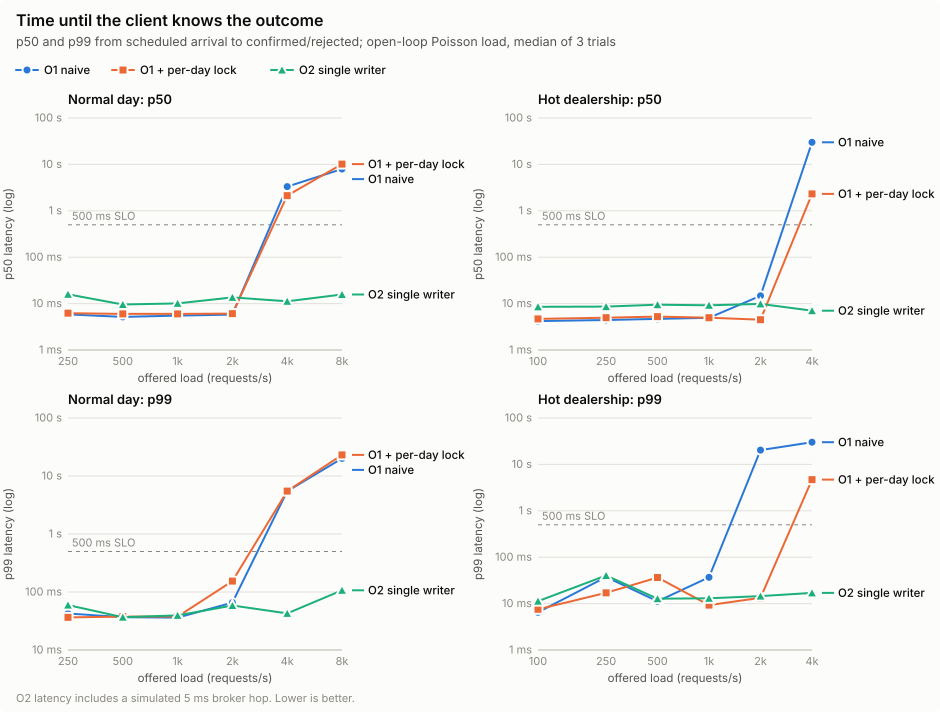
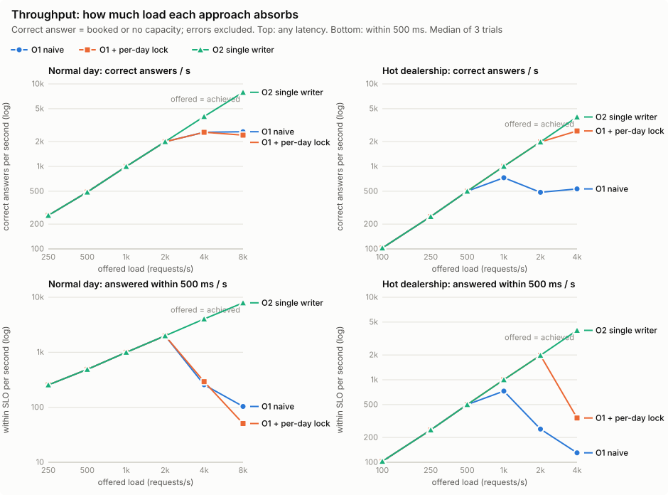
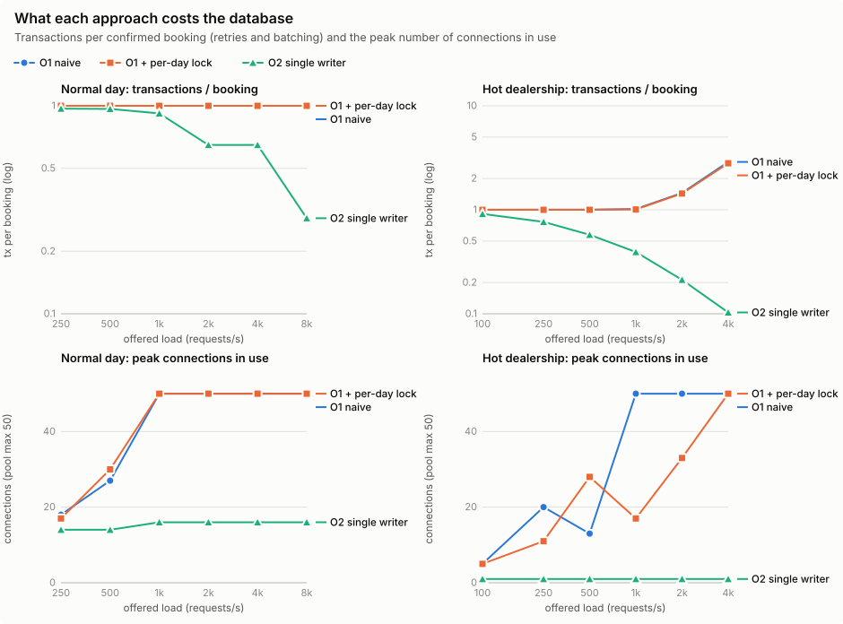
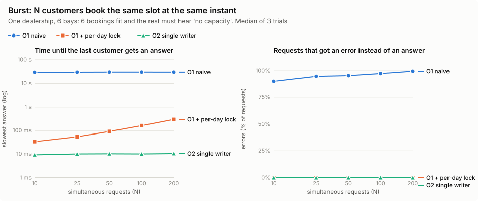

# Booking concurrency benchmark: O1 vs O2

2026-11-02 · harness: [`bench/BookingConcurrency`](../../bench/BookingConcurrency) · raw data:
[`results/full.csv`](../../bench/BookingConcurrency/results/full.csv)

**Question.** Where should the "no technician or bay is ever double-booked" rule live: in the
database, checked by every request (O1), or in one writer per dealership (O2)? And what does each
choice cost in throughput, latency and errors?

**Answer in short.**

- Both stay **correct** in every run: no overlapping bookings in 153 runs, and the rows written always
  equal the confirmations. Correctness was never the difference.
- The **straightforward O1** (constraint + retry) is not acceptable. When customers race for the same
  slot, its inserts deadlock each other, and Postgres breaks one deadlock per second. A burst of just
  10 requests had not finished after 30 s.
- **O1 with a per-dealership-day lock** fixes that and is the fastest option at normal volume (≈ 5 ms p50).
  It levels off at ≈ 2,500 answers/s on this machine, and it then holds every pool connection.
- **O2** had not reached its limit at the highest load tested (8,000 req/s), using at most 16 connections,
  and answered every 200-request burst in 10 ms. It pays ≈ 5–10 ms more per request at normal volume.

## 1. Latency: time until the client knows the outcome



- Below saturation, **O1 is about twice as fast at the median** (5–6 ms vs 9–16 ms). O2's figure
  includes the simulated 5 ms broker hop and waiting for its batch to commit.
- Once O1 saturates, latency jumps from milliseconds to **seconds**. On the normal day that happens
  between 2,000 and 4,000 req/s. With all traffic on one dealership, O1-naive's tail breaks at
  2,000 req/s (p99 20 s), O1 + lock at 4,000.
- O2's p99 stays under 110 ms across the whole range in both scenarios.

## 2. Throughput: how much load each approach absorbs



- **O1 plateaus at ≈ 2,500 correct answers/s** (normal day), whether naive or locked. The client used
  under 1.2 CPU cores at that point, so the bottleneck was the database doing one commit per request.
- Past the plateau, **goodput (answers within 500 ms) collapses** rather than levelling off: requests
  queue for connections and nearly all of them miss the SLO.
- **O2 tracks the offered load to the end of the range** (8,000 req/s normal, 4,000 req/s on a single
  dealership, which means a single worker). Its ceiling was not reached.
- On the hot dealership, **O1-naive degrades from 1,000 req/s**: deadlocks between concurrent inserts
  pile up and hold connections.

## 3. What each approach costs the database



- **O2 needs fewer transactions per booking as load grows** (0.29 at 8,000 req/s), because each worker
  writes everything it has drained in one batch. It also answers "no capacity" from memory without
  touching the database.
- O1 spends one transaction per request, including requests that end in "no capacity". That is why its
  hot-dealership line climbs above 1 even with no retries: at 2,000 req/s, 30% of requests find the
  slot full and still cost a round trip.
- **Connections:** both O1 variants reach the 50-connection pool limit from 1,000 req/s. O2 never uses
  more than 16 (one per partition), however much load arrives. With O1, one busy dealership can take
  every connection and slow down all the others. At 4,000 req/s on the hot dealership, O1-naive's
  ≈ 18,000 errors per run were all *pool timeouts*: deadlocked transactions held the connections until
  everyone else gave up.

## 4. Burst: N customers book the same slot at the same instant



Six bookings fit; every other customer should get a clean "no capacity".

- **O1-naive** never finished: in all 15 trials the harness cut it off at 30 s, with 1–3 bookings made
  and over 90% of requests left with an error. Every request picks the same first free
  technician and bay, the inserts deadlock pairwise, and Postgres resolves one deadlock per
  `deadlock_timeout` (1 s). Retries then rejoin the same pile-up. *Timing-sensitive:* in a preliminary
  single trial (first harness version, connected through Docker's port proxy, which spaces the arrivals
  out a little), a 50-request burst finished in 8 s with 88% errors. That trial is not in the charts.
  Either way the behaviour ranges from very bad to catastrophic.
- **O1 + lock** answers everyone correctly; its slowest answer grows linearly with N (34 ms → 300 ms)
  because requests queue on the lock one by one, each holding a connection while it waits.
- **O2** answers everyone in ≈ 10 ms at every N: the worker takes the whole burst as one or two batches.
- O1 + lock and O2 made **identical decisions** wherever both ran (e.g. hot, 2,000 req/s: 13,947 booked
  and 6,053 "no capacity" in all three trials). The in-memory decision matches the database one.

## What this means for the design

| | O1 naive | O1 + per-day lock | O2 single writer |
|---|---|---|---|
| Correct under concurrency | ✅ data, ❌ availability | ✅ | ✅ (constraints kept as backstop) |
| Latency at normal volume | ≈ 5 ms p50 | ≈ 6 ms p50 | ≈ 10 ms p50 (+ broker hop) |
| Capacity on this machine | ≈ 2,500 req/s; collapses under same-slot races | ≈ 2,500 req/s | > 8,000 req/s (not reached) |
| Same-slot burst of 200 | never drains (30 s cut-off) | 300 ms | 10 ms |
| Connections under load | all 50 | all 50 | ≤ 16, fixed |
| Extra moving parts | none | none | broker, partition ownership, async API |

- **Never ship O1-naive.** The database constraint keeps the data correct but not the service available.
- **O1 + lock covers realistic volume.** As a rough estimate, a dealer network generates tens of
  booking writes per second, two orders of magnitude below O1's plateau.
- **O2's case is headroom and isolation:** capacity beyond one database's commit rate, a fixed
  connection footprint, and one hot dealership can't starve the rest. Its price is a few
  milliseconds of latency and the operational weight of a broker.

## Method

| | |
|---|---|
| Machine | AMD Ryzen 7 5800U (8 cores / 16 threads), 13 GB RAM, laptop on the `powersave` governor |
| Database | PostgreSQL 16.1 in Docker: 4 CPUs, 2 GB, `shared_buffers=256MB`, `synchronous_commit=on`, `deadlock_timeout=1s` |
| Client | .NET 10.0.12, Npgsql 10.0.3, pool of 50 connections, same machine over the Docker bridge network |
| Load | Open-loop Poisson arrivals for 10 s per point; latency measured from each request's scheduled arrival |
| Repeats | 3 trials per point, approaches interleaved; charts show the median |
| Checks | After every run: zero overlapping bookings, and rows written = confirmations |

The approaches, scenarios, metric definitions and known limits are in the
[benchmark README](../../bench/BookingConcurrency/README.md). The largest caveats:

- An in-process channel stands in for the broker, plus a 5 ms delay per command. A real broker adds
  latency variance, durability cost and rebalancing, so O2's numbers are a best case for its
  latency and do not include cold start after a rebalance.
- One laptop runs everything, so absolute numbers depend on the machine. Compare the approaches with
  each other, not with production.
- O1 uses first-fit candidate selection (assumption A9). Randomising the candidate order would soften
  O1-naive's pile-ups but not remove them.

## Data

<details>
<summary>Median of 3 trials per point (click to expand)</summary>

"Errors" counts requests that ended in an error or were still waiting at the 30 s cut-off.
"Tx / booking" counts every attempt, retry, batch and schedule load, divided by confirmed bookings.

**Normal day** (500 dealerships)

| Offered req/s | Approach | Goodput req/s | p50 | p99 | Errors | Tx / booking | Peak connections |
|---:|---|---:|---:|---:|---:|---:|---:|
| 250 | O1 naive | 255 | 5.8 ms | 42.6 ms | 0 | 1.00 | 18 |
| 250 | O1 + per-day lock | 255 | 6.2 ms | 36.5 ms | 0 | 1.00 | 17 |
| 250 | O2 single writer | 255 | 15.9 ms | 59.4 ms | 0 | 0.97 | 14 |
| 500 | O1 naive | 489 | 5.2 ms | 36.8 ms | 0 | 1.00 | 27 |
| 500 | O1 + per-day lock | 489 | 6.0 ms | 37.7 ms | 0 | 1.00 | 30 |
| 500 | O2 single writer | 489 | 9.5 ms | 36.7 ms | 0 | 0.97 | 14 |
| 1000 | O1 naive | 999 | 5.5 ms | 36.2 ms | 0 | 1.00 | 50 |
| 1000 | O1 + per-day lock | 997 | 6.0 ms | 37.6 ms | 0 | 1.00 | 50 |
| 1000 | O2 single writer | 999 | 10.1 ms | 39.5 ms | 0 | 0.92 | 16 |
| 2000 | O1 naive | 1995 | 5.8 ms | 65.7 ms | 0 | 1.00 | 50 |
| 2000 | O1 + per-day lock | 1991 | 6.1 ms | 154.0 ms | 0 | 1.00 | 50 |
| 2000 | O2 single writer | 1994 | 13.6 ms | 58.5 ms | 0 | 0.65 | 16 |
| 4000 | O1 naive | 257 | 3318.6 ms | 5475.3 ms | 0 | 1.00 | 50 |
| 4000 | O1 + per-day lock | 293 | 2131.2 ms | 5492.6 ms | 0 | 1.00 | 50 |
| 4000 | O2 single writer | 4031 | 11.2 ms | 42.8 ms | 0 | 0.65 | 16 |
| 8000 | O1 naive | 104 | 7977.3 ms | 20102.7 ms | 0 | 1.00 | 50 |
| 8000 | O1 + per-day lock | 51 | 10152.3 ms | 23112.9 ms | 0 | 1.00 | 50 |
| 8000 | O2 single writer | 7919 | 15.7 ms | 106.8 ms | 0 | 0.29 | 16 |

**Hot dealership** (1 service centre, 40 technicians, 30 bays)

| Offered req/s | Approach | Goodput req/s | p50 | p99 | Errors | Tx / booking | Peak connections |
|---:|---|---:|---:|---:|---:|---:|---:|
| 100 | O1 naive | 103 | 4.2 ms | 6.5 ms | 0 | 1.00 | 5 |
| 100 | O1 + per-day lock | 103 | 4.7 ms | 7.5 ms | 0 | 1.00 | 5 |
| 100 | O2 single writer | 103 | 8.5 ms | 11.3 ms | 0 | 0.91 | 1 |
| 250 | O1 naive | 247 | 4.4 ms | 37.4 ms | 0 | 1.00 | 20 |
| 250 | O1 + per-day lock | 247 | 5.0 ms | 17.1 ms | 0 | 1.00 | 11 |
| 250 | O2 single writer | 247 | 8.6 ms | 40.4 ms | 0 | 0.77 | 1 |
| 500 | O1 naive | 501 | 4.7 ms | 11.2 ms | 0 | 1.00 | 13 |
| 500 | O1 + per-day lock | 501 | 5.2 ms | 36.5 ms | 0 | 1.00 | 28 |
| 500 | O2 single writer | 501 | 9.5 ms | 12.7 ms | 0 | 0.57 | 1 |
| 1000 | O1 naive | 729 | 4.9 ms | 36.9 ms | 0 | 1.02 | 50 |
| 1000 | O1 + per-day lock | 1003 | 5.0 ms | 9.3 ms | 0 | 1.01 | 17 |
| 1000 | O2 single writer | 1003 | 9.2 ms | 13.0 ms | 0 | 0.39 | 1 |
| 2000 | O1 naive | 252 | 14.7 ms | 20378.4 ms | 81 | 1.45 | 50 |
| 2000 | O1 + per-day lock | 1980 | 4.5 ms | 13.3 ms | 0 | 1.43 | 33 |
| 2000 | O2 single writer | 1979 | 9.9 ms | 14.5 ms | 0 | 0.21 | 1 |
| 4000 | O1 naive | 130 | 29999.1 ms | 30019.9 ms | 18278 | 2.89 | 50 |
| 4000 | O1 + per-day lock | 344 | 2310.4 ms | 4704.1 ms | 0 | 2.80 | 50 |
| 4000 | O2 single writer | 3972 | 7.0 ms | 17.0 ms | 0 | 0.10 | 1 |

**Burst** (1 dealership, 6 bays; 3 trials per size)

| N at once | Approach | Booked | "No capacity" | Errors | Deadlocks hit | Slowest answer |
|---:|---|---:|---:|---:|---:|---:|
| 10 | O1 naive | 1 | 0 | 9 | 26 | 30127 ms |
| 10 | O1 + per-day lock | 6 | 4 | 0 | 0 | 34 ms |
| 10 | O2 single writer | 6 | 4 | 0 | 0 | 9 ms |
| 25 | O1 naive | 1 | 0 | 24 | 29 | 30317 ms |
| 25 | O1 + per-day lock | 6 | 19 | 0 | 0 | 54 ms |
| 25 | O2 single writer | 6 | 19 | 0 | 0 | 10 ms |
| 50 | O1 naive | 2 | 0 | 48 | 30 | 30730 ms |
| 50 | O1 + per-day lock | 6 | 44 | 0 | 0 | 92 ms |
| 50 | O2 single writer | 6 | 44 | 0 | 0 | 10 ms |
| 100 | O1 naive | 3 | 0 | 96 | 30 | 30623 ms |
| 100 | O1 + per-day lock | 6 | 94 | 0 | 0 | 162 ms |
| 100 | O2 single writer | 6 | 94 | 0 | 0 | 10 ms |
| 200 | O1 naive | 1 | 0 | 199 | 31 | 30616 ms |
| 200 | O1 + per-day lock | 6 | 194 | 0 | 0 | 300 ms |
| 200 | O2 single writer | 6 | 194 | 0 | 0 | 10 ms |

</details>

## Reproduce

```bash
cd bench/BookingConcurrency
./run.sh full     # ~35 minutes: throwaway Postgres → 153 runs → CSV → these SVGs
```
